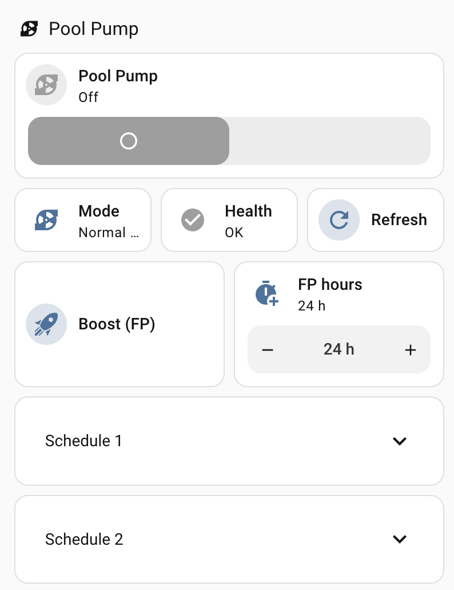

#  Intex SX2100 Pool Pump for Home Assistant

[](https://github.com/thomasgregg/intex-ha/releases)
[](https://github.com/thomasgregg/intex-ha/actions/workflows/validate.yml)
[](https://hacs.xyz)
[](LICENSE)

Local-first Home Assistant integration for the **Intex SX2100 WiFi sand
filter pump** (Tuya `AGP SAND FILTER PUMP R1`, category `rs`, product
`ff6aa9iqer5r7wtg`). Purpose-built for this pump, with every datapoint
verified against real hardware.

## Features

- **Local control** over your LAN via [tinytuya](https://github.com/jasonacox/tinytuya)
  (Tuya protocol 3.5) — switching and status work with no cloud dependency
- **Full schedule management** of the pump's 7 internal timer slots:
  enable/disable, start time, duration and repeat days, editable from the UI
- **FP mode**: start a one-time long filtration run (up to 48 h) with one
  button press — ideal after shock treatment or for cloudy water
- **Maintenance monitoring**: alarm codes (`E93`, `DIRTY`, …), decoded
  error bitmap, runtime counter, and a `problem` sensor ready for
  notification automations
- **HACS-ready** with automated releases, hassfest/HACS CI, and built-in
  diagnostics export

## Installation

**HACS** (recommended)

1. HACS → three-dot menu → *Custom repositories*
2. Add `https://github.com/thomasgregg/intex-ha` (type *Integration*)
3. Install **Intex SX2100 Pool Pump** and restart Home Assistant

**Manual**

Copy `custom_components/intex_sx2100` into your `config/custom_components/`
directory and restart.

Then add it under *Settings → Devices & Services → Add Integration →
Intex SX2100 Pool Pump*.

## Configuration

| Setting | Required | Notes |
|---|---|---|
| IP address | ✅ | e.g. `192.168.178.146` — give the pump a static DHCP lease |
| Device ID | ✅ | from the Tuya wizard (below) |
| Local key | ✅ | from the Tuya wizard; rotates if the pump is re-paired in the app |
| Tuya cloud client ID + secret | optional | from [iot.tuya.com](https://iot.tuya.com), enables schedule entities |
| Cloud region | optional | data center of your app account, e.g. `eu` |

Schedules live only in the Tuya cloud (`skdl_filter`), so the cloud
credentials unlock them; switching and sensors are pure LAN either way.
Polling intervals are adjustable via the integration's *Configure* dialog
(defaults: local 15 s, cloud 15 min — well within Tuya's free API tier).

### Getting the device ID and local key

The pump talks on the LAN using a per-device **local key**. Tuya doesn't
show it in the app, so you retrieve it once via a free Tuya developer
account and the `tinytuya` wizard. You only do this once (the key stays
valid unless you re-pair the pump in the app).

**1. Pair the pump in the Intex / Smart Life app** (if you haven't already),
and confirm it works there.

**2. Create a Tuya IoT Platform cloud project.** Sign up at
[iot.tuya.com](https://iot.tuya.com) → *Cloud* → *Development* → *Create
Cloud Project*. Pick the **data center that matches your region** (e.g.
*Central Europe* for `eu`) — this must match the region your app account
uses. After creating it, the project's *Overview* tab shows an
**Access ID** (client ID) and **Access Secret** (client secret) — note both.

**3. Link your app account to the project.** In the project, open
*Devices* → *Link App Account* → *Add App Account*, then scan the shown QR
code with the Intex/Smart Life app (*Me* → top-right scan icon). Your pump
now appears under the project's devices.

**4. Run the wizard.** On any computer with Python:

```bash
python3 -m pip install tinytuya
python3 -m tinytuya wizard
```

It asks for the **Access ID**, **Access Secret**, and a region (`eu`,
`us`, `cn`, or `in`). It then downloads your device list and writes a
`devices.json` file (and prints the results). Find your pump's entry — the
fields you need are:

- `id` → **Device ID**
- `key` → **Local key**
- `ip` → the pump's LAN **IP address** (if blank, the wizard's network
  scan couldn't reach it — get the IP from your router instead)

**5. Enter them in Home Assistant** when adding the integration. The
**Access ID / Access Secret** from step 2 are also exactly what you enter
as the optional *cloud client ID / secret* to enable schedules.

> [!TIP]
> Re-pairing the pump in the app rotates the local key — if local control
> suddenly fails with an auth error, re-run the wizard to get the new key.

Prefer a web UI over the command line? The same values are on the Tuya
site: *Cloud* → your project → *Devices* → *Device List* shows each pump's
Device ID, and *Cloud* → *API Explorer* → *Query Device Details Info*
returns the `local_key`.

## Entities

| Entity | Description |
|---|---|
| `switch.intex_pool_pump` | Filtration on/off |
| `sensor.intex_pool_mode` | Pump mode: `Normal cycle` / `FP run` / `Sleep` / `Boost` (mode, not motor activity — the pump switch shows on/off) |
| `sensor.intex_pool_alarm` | `normal` / `E93` / `DIRTY` / `unnormal` |
| `sensor.intex_pool_error_code` | Decoded fault code, e.g. `E90`; `none` when healthy (E93 standby is not a fault) |
| `sensor.intex_pool_working_time` | Hours remaining in the current run (matches the app; 0 when idle) |
| `binary_sensor.intex_pool_problem` | On for real faults/errors — automation-ready (ignores `E93` standby) |
| `sensor.intex_pool_schedule` | Active timer slots, decoded details in attributes |
| `switch.intex_pool_slot_N` | Enable/disable schedule slot N (1–7) |
| `time.intex_pool_slot_N_start` | Slot start time |
| `number.intex_pool_slot_N_hours` | Slot run time (1–48 h) |
| `text.intex_pool_slot_N_days` | Repeat days: `daily`, `once` (FP) or `mon,wed,fri` |
| `button.intex_pool_start_fp` | Start a one-time FP run (~1 min from now) |
| `button.intex_pool_refresh` | Force an immediate re-poll (local + cloud) |
| `number.intex_pool_start_fp_hours` | Duration for the Start FP button |

Slot editors appear in the **Configuration** section of the device page;
all 7 slots are shown so FP runs and app-created schedules always appear.
Diagnostic extras (mesh indicator, filter switch) are disabled by default.

## Schedules

Each of the 7 slots holds either a **repeating timer** (start + duration +
days) or a dated one-time **FP entry**. The slot switch mirrors the app's
enable toggle; the `days` field accepts friendly syntax:

```text
daily            every day
mon,wed,fri      specific days (full names and spaces work too)
once             dated one-time entry (FP)
```

### FP mode

FP is the pump's "run long hours once, then return to the normal cycle"
feature — up to 48 h of continuous filtration for shock treatments, cloudy
water or heat waves. Set `number.intex_pool_start_fp_hours`, press
`button.intex_pool_start_fp`, and the pump starts within ~1 minute. Like the
Intex app, FP always uses **slot 1** (the app's dedicated FP-mode slot), so
your repeating schedules in the other slots are never touched.

### Services

```yaml
# Configure a slot in one call
action: intex_sx2100.set_schedule_slot
data:
  slot: 1
  enabled: true
  hour: 6
  minute: 0
  duration: 8
  days: 255   # week byte; 255 = every day

# Free a slot
action: intex_sx2100.clear_schedule_slot
data:
  slot: 1
```

## Automations

Alarm notification:

```yaml
alias: Pool pump alarm
triggers:
  - trigger: state
    entity_id: binary_sensor.intex_pool_problem
    to: "on"
actions:
  - action: notify.notify
    data:
      title: "Pool pump problem"
      message: >-
        The pump reports
        {{ state_attr('binary_sensor.intex_pool_problem', 'code') }}.
```

Offline alert:

```yaml
alias: Pool pump offline
triggers:
  - trigger: state
    entity_id: binary_sensor.intex_pool_problem
    to: "unavailable"
    for: "00:05:00"
actions:
  - action: notify.notify
    data:
      title: "Pool pump offline"
      message: "The pump has been unreachable for 5 minutes."
```

## Dashboard card



A ready-made card lives in
[`examples/dashboard-card.yaml`](examples/dashboard-card.yaml) — paste it
into a manual card.

- **Tile controls** for pump toggle, mode, health, refresh, and a one-tap
  **Boost (FP)** button with +/- duration input (all built-in card types)
- **Collapsible, self-updating schedules**: each slot is wrapped in a
  conditional card that renders only while the slot is in use, inside a
  collapsible header — so schedules appear/vanish automatically and stay
  tucked away until you expand them

The schedule sections use the [Expander Card](https://github.com/MelleD/lovelace-expander-card)
(install from HACS — search "Expander Card"). Pattern per slot:

```yaml
- type: conditional
  conditions:
    - condition: numeric_state
      entity: number.intex_pool_slot_1_hours
      above: 0
  card:
    type: custom:expander-card
    title: Schedule 1
    expanded: false
    title-card-clickable: true
    cards:
      - type: entities
        entities:
          - entity: switch.intex_pool_slot_1
            name: Enabled
            secondary_info: attribute
            attribute: summary
          - entity: time.intex_pool_slot_1_start
            name: Start
          - entity: number.intex_pool_slot_1_hours
            name: Hours
          - entity: text.intex_pool_slot_1_days
            name: Days
```

If you prefer no extra install, replace `custom:expander-card` with a plain
`entities` card (drop the `expanded`/`title-card-clickable` lines) — you lose
the collapsing but keep everything native.

## Protocol reference

Everything below was verified against real hardware; the DP names come
from the pump's official Tuya thing model (available on any install via
*Device page → Download diagnostics*).

<details>
<summary>Datapoints</summary>

```text
protocol: 3.5 (3.3 -> Err 904, 3.4 -> Err 914)

DP 104: power_switch       rw bool (true -> working_indicator shows FP_mode)
DP 106: filter_switch      rw bool
DP 110: working_time       ro value, 0-250 hours
DP 114: error_code         ro bitmap; bits -> 181,180,190,191,192,193,
                           194,195,196,199,200,197 (label 1xx = app code Exx;
                           verified: bit 5 (32) set while DP 127 showed E93)
DP 115: skdl_filter        rw raw — schedule blob (cloud-only)
DP 119: mesh_indicator     ro bool
DP 125: working_indicator  enum: working / FP_mode / sleep / boost
DP 127: warntype_indicator enum: normal / E93 / DIRTY / unnormal
        (E93 = standby / power-saving, NOT a fault; DIRTY = clean the
        filter; other non-normal values and any error_code bit = fault)
```

Each poll and command uses a fresh, non-persistent socket — persistent
sockets were observed to serve stale DP values and swallow commands.

</details>

<details>
<summary>Schedule blob format (skdl_filter)</summary>

Base64-encoded, 7 fixed slots × 8 bytes:
`month date hour minute worktime week control pad`

Week byte (live-verified: Mon-only → 192, Wed-only → 144):

```text
bit 7 (128) = weekly-repeat flag
bit 6 (64)  = Mon    bit 5 (32) = Tue    bit 4 (16) = Wed    bit 3 (8) = Thu
bit 2 (4)   = Fri    bit 1 (2)  = Sat    bit 0 (1)  = Sun
255 = every day · 0 = dated one-time FP entry
```

The `control` byte is the app's enable toggle. Decode/encode round-trips
the real pump's blob byte-identically.

</details>

## Comparison with `Hovborg/intex-pool`

This comparison was checked against
[`Hovborg/intex-pool` v0.21.2](https://github.com/Hovborg/intex-pool/tree/v0.21.2).
That integration is the stronger choice for a mixed Intex setup; this one goes
deeper on the SX2100 itself. If the pump is your target, the differences are
more than scope or presentation:

| Area | This integration (`intex-ha`) | `Hovborg/intex-pool` v0.21.2 |
|---|---|---|
| **Design target** | Dedicated to the SX2100 / AGP Sand Filter Pump R1, with a small pump-only entity and dependency surface | A multi-device hub for water analyzers, saltwater systems, Tuya pumps, and pumps represented by another HA switch |
| **Minimum Home Assistant** | **2024.12.0** | **2025.8.0** |
| **Start FP** | **First-class workflow:** choose 1–48 hours with the **Start FP hours** entity, then press **Start FP**. It creates the dated one-time run used by the Intex app without disturbing the other six slots | No dedicated pump FP button or duration control; existing one-time slots are exposed through the generic schedule entities |
| **Schedule enable vs delete** | Mirrors the pump's two distinct operations: each slot switch changes only its `control` enable byte, while **Clear schedule slot** deliberately erases the record | The pump-slot switch represents record presence; turning it off clears all eight slot bytes and relies on HA's remembered state to restore them later |
| **Repeat days** | A writable entity for every slot accepts `daily`, `once`, or friendly input such as `mon,wed,fri`; the verified SX2100 week-bit mapping is hidden from the user | No per-slot weekday entity for the pump; its start-time and duration entities do not expose repeat-day editing |
| **Pump schedule services** | Dedicated `set_schedule_slot` and `clear_schedule_slot` services target the pump directly, use human-facing slot numbers 1–7, and preserve unspecified fields | `get_schedule` can return the pump table, but the writable `set_schedule` service selects the saltwater-system schedule; pump edits are primarily entity-driven |
| **FP/enable interpretation** | Treats `control` as the independent enable toggle and identifies FP from the dated one-time pattern (`days == 0`), matching observed SX2100 blobs | Its shared schedule summary maps `control == 0` to `boost`; there is no dedicated SX2100 FP interpretation or action |
| **DP 114 errors** | **True bitmap decoder:** reports every set error bit, maps the thing-model labels to app codes, and keeps E93 standby out of the fault list | Applies a single integer error-code lookup to DP 114, so SX2100 bitmap values and simultaneous bits are not decoded individually |
| **Actionable fault state** | A ready-to-automate **Problem** binary sensor combines the pump's DP 127 alarm with genuine DP 114 faults and includes descriptions plus all active codes | Exposes separate pump alarm/error sensors; its broader Action required roll-up does not include a pump-only installation |
| **On-demand refresh** | One **Refresh** button immediately re-polls both the local pump and its cloud schedule | Pump data refreshes on its polling intervals; its refresh/re-test buttons belong to the water analyzer and saltwater system |
| **Schedule cloud usage** | Schedule polling is user-configurable from 60 seconds to 24 hours (default 15 minutes), useful for conserving the Tuya developer quota | Pump schedule polling is fixed at 10 minutes |
| **Frontend footprint** | Backend-only: standard HA entities and an optional YAML dashboard example, with no custom frontend or HTTP dependency | Includes an adaptive custom dashboard card served by the integration; this is an advantage when a bundled multi-device UI is preferred |
| **Where the broader project wins** | Focus and pump-specific behavior are intentional; it does not manage other pool equipment | Cloud discovery, protocol auto-detection, reauthentication, a bundled card, and support for several equipment types in one integration |
| **Best fit** | **You want the most faithful SX2100 controls, FP workflow, schedule semantics, and fault decoding** | You want one integration and dashboard spanning a larger pool system |

## Credits

The 7×8-byte schedule blob format follows the reverse-engineering documented
in `Hovborg/intex-pool` (MIT). This integration is an independent
implementation.

## License

[MIT](LICENSE)
